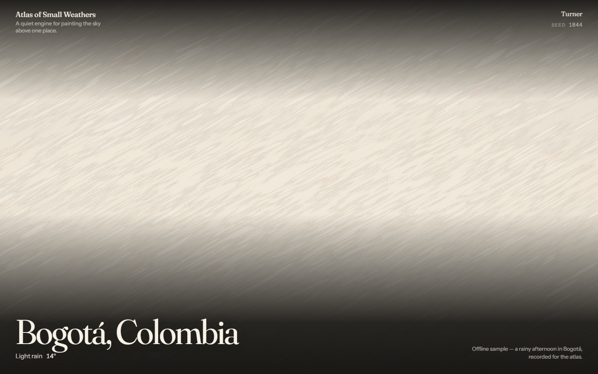

# Atlas of Small Weathers

[](https://github.com/mpinedaj/atlas-of-small-weathers/actions/workflows/ci.yml)

**Your sky, painted.** An open-source generative-art engine that turns live weather into slow,
abstract paintings — one city, one seed, one small weather at a time.

Built with TypeScript, Vite and hand-written WebGL2. Weather data by
[Open-Meteo](https://open-meteo.com/). Painterly "schools" (Turner, Rothko, Hokusai) are
self-contained plugins.

MIT licensed. Palettes and community renders are shared under CC BY 4.0.



## Quick start

```bash
npm install
npm run dev
```

Open `http://localhost:5173`. For deterministic screenshots and tests:

```bash
npm run dev
# then
npx playwright test
```

## What it does

- Reads live weather for one place and paints it, slowly.
- Reproduces any painting from its URL (`city`, `lat`, `lon`, `school`, `seed`, `mode`).
- Offers three schools: `turner`, `rothko`, `hokusai`. Add your own in `schools/`.
- Falls back to a 2D painting when WebGL2 is unavailable.

## Architecture

See [`docs/architecture.md`](docs/architecture.md) and [`docs/decisions.md`](docs/decisions.md).
Schools are discovered from `schools/*` with `import.meta.glob`; the contract is in
[`docs/schools.md`](docs/schools.md).

## Data

Open-Meteo current weather and geocoding, cached with TTLs, with an honest offline sample.
See [`docs/mapping.md`](docs/mapping.md) for how weather becomes gesture.

## Contributing

See [`CONTRIBUTING.md`](CONTRIBUTING.md). A first school in fifteen minutes:
[`docs/create-a-school.md`](docs/create-a-school.md).

## Credits

Weather by Open-Meteo. Type by Fraunces and Instrument Sans (Fontsource). Built by Martin Pineda.
